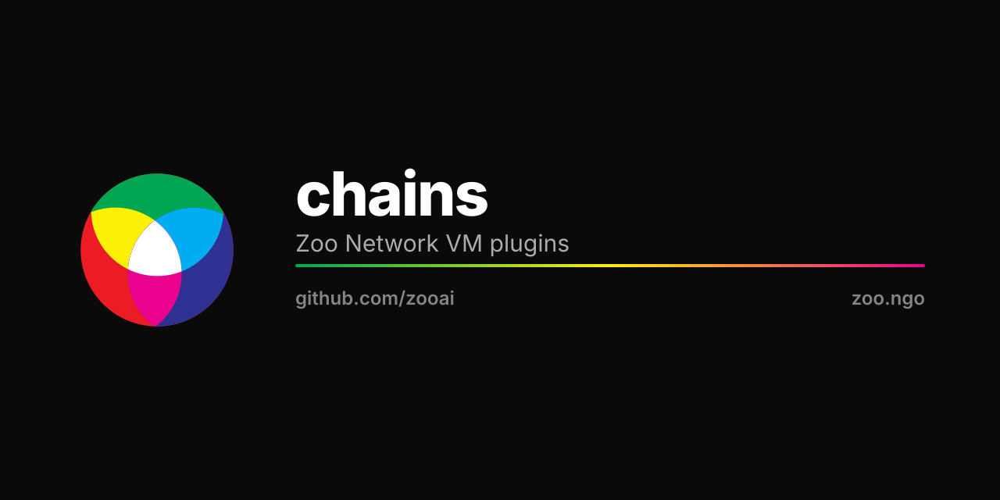

<p align="center"></p>

# Zoo Chains

[](https://hanzo.app/dev/open?repo=github.com/zooai/chains&ref=main&action=open) [](https://hanzo.app/dev/open?repo=github.com/zooai/chains&ref=main&action=edit)

VM plugin binaries for the Zoo Network. Includes all standard Lux VMs plus Zoo-specific chains.

## Standard VMs (from Lux)

aivm, bridgevm, dexvm, evm, graphvm, identityvm, keyvm, oraclevm, quantumvm, relayvm, servicenodevm, teleportvm, thresholdvm, zkvm

## Zoo-Specific VMs

- **zoo-evm** — Lux EVM with Zoo precompiles (PQ crypto, threshold sigs, DEX)

## Build

```bash
make            # build all
make zoo-evm    # build one
```

## Install

```bash
lpm install-github zooai/chains --pattern "zoo-evm-{os}-{arch}"
```
